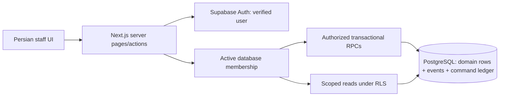

# MizFlow · میزفلو

**One shared service record, from seating to the kitchen and back.**

MizFlow is a Persian RTL café application submitted by **Reina Khosravi** for the AI Product Owner assessment. It focuses on one workflow: seat a party, take/extend an order, prepare and deliver each item, then release the table for the next party. It uses real Supabase identities, PostgreSQL persistence and database authorization—not a mock login or a localStorage backend.

**Start here:** [submission index](SUBMISSION.md) · [agreed scope](SCOPE.md) · [decisions](DECISIONS.md) · [AI disclosure](AI_USAGE.md) · [owner handover](HANDOVER.md)

**Repository:** https://github.com/ReinaKhosravi/mizflow-po-assessment

**Live HTTPS demo:** https://mizflow-po-assessment.vercel.app

Verified hosting details are recorded in SUBMISSION.md. Demo passwords are supplied separately in the assessment access-credentials field, never in this public repository.

## What the product does

- Persian RTL, self-hosted Vazirmatn, dark/light/system appearance and touch-sized controls.
- A twelve-table نارون hall, naturally numbered ۱–۱۲: eight four-seat tables and four two-seat tables. The arrangement is illustrative; filters show free, occupied and awaiting-order tables.
- Seating/menu presentation before items are submitted; persisted orders and append-only additions with preparation notes.
- Kitchen queued → preparing → ready; waiter delivery records server time and authenticated actor, and removes served work from the kitchen queue.
- Another round while guests remain seated; explicit departure/table release; a new order for the next party.
- Server-authoritative integer IRR snapshots; visible prices divide by ten and say تومان. No financial settlement is implied.
- Two fictional, isolated cafés, role-specific demo accounts and historical fixtures. Café روز has its own eight-table dataset.

**Not implemented:** payment, discounts, fiscal invoices, inventory, suppliers, autonomous purchasing, product AI, onboarding/invitations, password recovery, tenant switching, multi-branch staff assignment, durable offline drafts or a floor-plan editor. Configuration privileges in SQL do not imply a configuration UI. See [known limits](HANDOVER.md#known-limitations).

## Run locally

Node.js 24+ and npm are required. Verified development tools were Node 26.0.0 / npm 11.12.1. Preserve the lockfile.

1. Copy `.env.example` to ignored `.env.local` on a fresh checkout.
2. Set only `NEXT_PUBLIC_SUPABASE_URL` and `NEXT_PUBLIC_SUPABASE_PUBLISHABLE_KEY` for ordinary application requests. A local legacy anon JWT is also supported. Never put a secret/service-role key in a public variable.
3. With the configured, migrated demo database, start with one command:

```sh
npm ci && npm run dev
```

Open http://localhost:3000. Missing/invalid configuration fails closed to setup guidance. A build without credentials does not prove authentication works.

For an existing production build:

```sh
npm run build && npm start
```

The scripts use the existing Webpack mode. No product/dependency changes were made during submission packaging.

### Reproduce the database and demo

A fresh local Supabase stack requires Docker and locally configured public/seed credentials. Copy the empty templates from `config/` into the separate ignored files; do not commit populated values.

```sh
npm ci && npm run db:start && npm run db:migrate && npm run db:seed && npm run dev
```

This chain assumes the local Supabase values have been configured, including the offline development seed key/password. It does not invent credentials or silently bypass authentication. `npm run db:reset` destroys local data; use it only for a disposable local stack. Never apply `supabase/tests/bootstrap-postgres.sql` to Supabase—it is only the isolated PostgreSQL test bootstrap.

For the already configured Cloud demo, inspect `npm run db:check:cloud` and [DATABASE.md](docs/DATABASE.md). All five migrations are already recorded there; do not blindly replay SQL or reset its data. Offline seed/setup tools require explicit development-target confirmation and keep privileged credentials out of ordinary user traffic.

| Migration                            | Purpose                                                                    |
| ------------------------------------ | -------------------------------------------------------------------------- |
| `202610310001_tenant_foundation.sql` | Eight domain tables, scoped relationships, grants/RLS and immutable events |
| `202611010001_order_workflow.sql`    | Locked order/preparation RPCs and private idempotency ledger               |
| `202611010002_domain_conflicts.sql`  | Final business conflicts return PT409/HTTP 409                             |
| `202611010003_owner_ordering.sql`    | Owner coverage of staff workflows within its own restaurant                |
| `202611010004_table_service.sql`     | Served actor/time, per-item delivery and table release/reuse               |

The base seed is idempotent and preserves existing accounts/passwords/business rows. `db:demo:workflow` adds the second waiter and walkthrough items. `db:demo:reset` only resets the explicitly marked table-12 development scenario, not arbitrary customer work. The guarded offline hall normalizer keeps twelve canonical active نارون tables and preserves retired fixture history.

## Architecture



- `src/app/(workspace)`: guarded dashboard, hall, menu, kitchen and table detail.
- `src/features/auth`: SSR session, trusted membership, permissions and owner-only work-panel preference.
- `src/features/orders`: input/read boundaries, Server Actions, scoped queries, polling and operational UI.
- `src/lib/supabase`: request-local public-key SSR client. `src/proxy.ts` refreshes cookies; it is not the authorization boundary.
- `supabase/migrations`: ordered schema and commands. `private.order_commands` is inaccessible to ordinary users.
- `scripts`: offline guarded provisioning/migration/demo tools. No administrative key is imported into the application.
- `tests/database`, `tests/supabase`, `tests/e2e`: separate evidence for SQL, actual Auth/PostgREST and browser behavior.

RLS and explicit grants restrict reads; composite FKs reject cross-scope references. Mutation RPCs resolve the actual active actor, lock membership/resources, enforce transitions, snapshot prices and append audit events in the same transaction. Replays must match actor, command, target and payload. A partial unique index prevents duplicate active orders per table. An owner panel cookie never grants a role. See [SECURITY.md](docs/SECURITY.md) for the implemented boundary.

Operational screens poll after roughly four seconds plus response time and pause while hidden. They display connection/error states and never replace failed reads with mock restaurant data. Unsent choices do not survive reload; ambiguous requests retain the original command identity. A cart cannot silently move to a newly seated party.

## Verification

```sh
npm run typecheck
npm run lint
npm test
npm run test:db
npm run test:supabase
npm run build
MIZFLOW_E2E_PRODUCTION=1 PLAYWRIGHT_CHANNEL=chrome npm run test:e2e
npm run format:check
```

`test:db` creates/removes a real temporary PostgreSQL cluster using installed `initdb`/`pg_ctl` (verified 17.10). It never reads a customer's DB URL. Real API/browser suites require explicit demo-only settings from `config/test.env.example` in ignored `.env.test.local`; otherwise they skip and are not evidence of isolation. They must run sequentially because membership probes temporarily revoke/restore a demo identity. They borrow a free physical table and refuse to overwrite an occupied one.

Latest completed checks before freeze: TypeScript/lint/build passed; **31 unit tests**, **31 reported PostgreSQL tests** and **21 reported real Supabase tests** passed. The final browser run was stopped at the user's request: **11 passed, 1 interrupted, 6 not run**. An earlier full run had 17 passes and one tablet refresh timeout; the correction was not followed by a completed full matrix before freeze. [TEST_REPORT.md](docs/TEST_REPORT.md) states the exact evidence and exclusions. Do not infer a production certification from these results.

## Delivery status

The core scope was established before implementation; the submitted [SCOPE](SCOPE.md) consolidates it and later explicit refinements. The applicant reports approximately 4.5 hours. **Product AI is absent**, so the AI-capability line of the brief remains a disclosed gap; [the AI assessment](docs/AI_CAPABILITY_ASSESSMENT.md) is a proposal, not a shipped feature.

Before a paid-shift rollout, verify hosted Auth/rate limits, rotate any previously disclosed administrative credential, validate real devices/expired SSR refresh, add monitoring and prove backup restoration. The kitchen has a visible 100-item display limit; larger-order/list pagination and durable offline work remain limits. This release is a supervised demonstration/pilot artifact, not a claim that those operational checks are complete.
